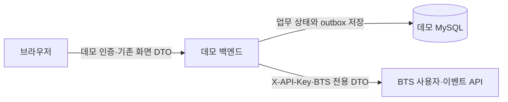

# BTS 사용자·이벤트 API 연동 설계

**Issue #16 현재 구현:** Demo Ticketing의 `PolicyDecisionClient`와 명시적 Mock 설정으로 ALLOW/REQUIRE_CAPTCHA/DELAY/RESTRICT에 따른 등록·CAPTCHA·차등 Redis 대기열을 구현했다. 실제 BTS `POST /api/v1/users/{userId}/policy-decisions` (`context=QUEUE_JOIN`, 응답 `data.action`) 호출 구현과 해당 원격 API의 가용성 검증은 이번 범위에 포함하지 않았다. 기존 사용자·이벤트 BtsClient 및 Outbox는 유지한다. `latestAction`을 이번 신규 결정 응답 대신 사용하지 않는다.

실제 구현체로 교체할 때 userId는 서버에 저장된 BTS UUID이고 인증은 서버 전용 X-API-Key다. 현재 UUID는 최초 Outbox 전송 때 매핑하므로 대기열 등록 시 null일 수 있다. 사전 매핑과 실패 처리는 실제 정책 연동 시 해결할 과제다. Mock은 인증된 DemoUser.publicId를 서버 설정과 비교하며 가짜 UUID를 생성·저장하지 않는다. 정책 장애·알 수 없는 응답을 ALLOW로 우회해서는 안 된다. 활성 WAITING/ADMITTED에는 정책을 재적용하지 않고, 이탈·만료 후 새 등록에서 다시 평가한다.

Mock CAPTCHA는 시연용 산술 문제와 서버의 일회용 증명이며 실제 봇 방지 서비스가 아니다. 실제 CAPTCHA 연동은 별도 후속 작업이다. [현재 구현·설정·미완료 범위](../backend/scripts/README-PriorityQueue.md)를 우선 참고한다.

기준일: 2026-11-01. 근거는 사용자가 제공한 **실제 BTS 사용자·이벤트 API 명세**와 FE 코드다. 초기 설계 시에는 BTS 소스가 미확인이었고, 1단계에서 아래 인접 저장소 소스를 추가 확인했다. 확정 계약과 신규 설계를 구분하며 실제 BTS 연동 구현은 아직 하지 않았다.

**1단계 구현 후속:** 인접 `../backend`의 실제 BTS build.gradle, user Controller/Entity/DTO, common 응답/예외, db/schema.sql을 읽기 전용으로 확인했다. 데모 backend는 이 레이어·응답/예외·SQL 수동 관리 컨벤션과 Java/Boot/Gradle 기준을 참고해 조회 API만 구현했다. BTS 소스/DB·인증·Event API는 수정하지 않았고, 이 문서의 매핑/Outbox/metadata 전송은 여전히 후속 설계다. 초기 ‘소스 미확인/문서 한정’ 설명은 이전 설계 시점의 근거를 나타낸다.

**DB 운영 결정:** 데모는 별도 Compose demo-ticketing-mysql / localhost:3308 / demo_ticketing_db / demo_user / demo-ticketing-mysql-data 볼륨을 사용한다. 기존 BTS fairticket-mysql(3307)과 DB·사용자·볼륨을 공유하지 않는다. .env 비밀로 독립 초기화했으며 BTS root 인증 우회/재시도 설정은 제거했다. 조회 API·BTS 서버 간 X-API-Key/DTO·세 이벤트·Outbox 연동 설계는 변경하지 않는다.

관련 문서: [데모 API 명세](api-spec.md), [데모 ERD](erd.md).

## 2단계 구현 상태와 장애 정책

- 구현: 서버가 실제 예매/취소를 commit할 때 각각 BOOKING/CANCEL 원천과 Outbox를 함께 저장한다. 선점·만료·화면 클릭은 보내지 않는다. ticket ID는 생성하지만 검표/CHECK_IN과 QR는 아직 없다.
- 기존 핵심 8개 테이블을 재사용하고 demo_sessions/outbox_events를 추가했다. DemoUser/ReservationRecords는 JDBC Repository가 매핑하는 도메인 entity record이며 HTTP DTO와 분리했다. 공연 읽기는 기존 JPA 경로를 유지한다.
- 신규 사용자 공개 ID를 고정 externalUserId로 저장한다. 등록 API는 로컬 데모 세션을 반환하며 BTS 연결이 없어도 사용 가능하다. 전송기는 최초 이벤트 처리 시 POST /users를 serviceId/externalUserId/accountStatus로 호출하고 200/COMMON_200·201/COMMON_201 모두 받아 UUID를 매핑한다. 기존 UUID와 불일치는 자동 변경하지 않는다.
- BTS_ENABLED=false가 기본이다. 이때 네트워크 호출 없이 PENDING 원천을 보존한다. true이면 BTS_BASE_URL/BTS_SERVICE_ID/BTS_API_KEY가 필요하며 remote URL은 HTTPS(루프백 테스트만 HTTP)를 사용한다. API Key는 .env/런타임에만 있고 브라우저·payload·로그에 넣지 않는다. 실제 발급 service ID는 사용자/이벤트 생성 전에 결정해야 하며 기존 매핑의 namespace를 임의로 바꾸지 않는다.
- 최종 전송 전 UUID만 결합해 payload를 한 번 만든 뒤 **LONGTEXT + JSON_VALID CHECK**로 보존한다. JSON 컬럼의 출력 정규화와 무관하게 재시도 body bytes를 그대로 유지하려는 선택이며 metadata는 JSON 원형으로 저장한다. externalEventId/발생 시각/metadata는 업무 성공 때 이미 고정된다. 재시도로 재계산하지 않는다.
- 전송기는 READ COMMITTED 트랜잭션에서 SELECT FOR UPDATE SKIP LOCKED로 같은 serviceId의 due 이벤트를 claim하고 60초 lease/임의 lease token을 부여한다. 네트워크는 로컬 트랜잭션 밖에서 수행한다. 응답 기록도 lease token이 일치할 때만 가능하다. 중단된 IN_FLIGHT는 lease 만료 후 복구한다.
- 같은 예매에서 앞선 이벤트가 SENT일 때만 뒤의 CANCEL을 전송한다. failed BOOKING을 새 ID로 우회하거나 CANCEL만 앞서 보내지 않는다. 200/COMMON_200·201/COMMON_201은 SENT, 접속/timeout/5xx는 같은 payload로 지수 backoff(2초부터), 최대 8회 시도 후 FAILED. 400/401/403/404/409 등 비재시도 오류는 즉시 FAILED이며 안전한 code만 저장한다. 응답 검증 실패도 격리한다.
- DB 등록 성공 후 매핑 저장 실패, 서버 저장 후 응답 실패, worker 중단 모두 같은 사용자 외부 ID/이벤트 ID로 복구한다. 운영 재처리가 필요하면 원인과 기존 BTS 레코드를 확인한 후 같은 payload/ID를 유지한 채 상태를 재개해야 한다. 자동 key 교체·UUID 초기화·새 ID 우회·BTS DB 직접 수정은 하지 않는다. 공개 관리 API는 없다.
- paymentIdentifier는 허용된 테스트 식별자, ipAddress는 연결 peer에서 산출한다. Forwarded/X-Forwarded-For를 전부 무시하도록 설정했다(현재 신뢰 프록시 구성이 없음). duration은 해당 hold 생성~서버 확정의 소수 초이며 occurredAt은 UTC 초 단위 Z다. JVM 기본 시간대가 KST여도 JDBC LocalDateTime으로 UTC DATETIME 원천을 읽는다.
- 실제 BTS 환경의 URL·발급 키·service ID는 현재 별도 설정이 필요하다. 전용 HTTP 계약 서버를 이용한 등록·멱등 성공·저장 후 503·409·동일 payload 재시도와 접속 거절을 검증한다. 이 검증을 실제 BTS 인스턴스의 이벤트 수신 확인으로 표현하지 않는다. BTS Feature 추출은 여전히 별도 레포의 후속 작업이다.

**확정된 연동 방식:** eventType은 BOOKING/CANCEL/CHECK_IN을 유지하고 Feature 원천 데이터는 metadata로 전달한다. 데모는 업무 사실과 원천값만 제공하며 Feature 계산은 BTS가 담당한다. 아래 4.5절의 metadata 수집 프로필은 이 결정에 따른 설계이며, BTS Event API의 기존 필수 필드/인증/시간/멱등성 계약을 변경하지 않는다. 추가 metadata를 저장할 수 있다는 것과 기존 Feature 추출기가 이를 읽는다는 것은 별개다.

## 1. 두 API 경계



| 구분 | 데모 외부 API: 브라우저→데모 | BTS 서버 간 API: 데모→BTS |
|---|---|---|
| 사용자 등록 | 기존 FE는 POST /api/v1/users에 {userId} 전송. 호환 adapter 유지안이며 데모 인증 계약은 별도 미정 | POST /api/v1/users에 serviceId, externalUserId, 선택 accountStatus |
| 사용자 식별 | 데모 내부 ID/공개 ID, 본인 여부는 데모 인증으로 확인 | 응답 UUID userId, 서비스 소유 범위는 X-API-Key로 확인 |
| 이벤트 | 기존 /events의 9종 행동은 데모 텔레메트리 후보 | POST /api/v1/events, BOOKING/CANCEL/CHECK_IN만 허용 |
| 인증 | 데모 사용자 세션/token 방식 미정 | 단일 X-API-Key. 브라우저에 전달 금지 |
| 응답 | 필드 envelope는 FE와 호환. common 응답/예외 컨벤션 유지 | 실제 COMMON_200/COMMON_201, 확정 오류 코드 사용 |

같은 경로 이름이어도 origin과 DTO·인증 주체가 다르다. 데모 /users와 /events는 BTS에 대한 무검증 reverse proxy가 아니다. 클라이언트가 serviceId, BTS UUID, eventType을 임의로 골라 서버 간 요청을 만들 수 없게 한다. BTS API Key는 **서비스 인증**이며 데모 사용자의 본인 인증을 대신하지 않는다.

## 2. BTS 인증·직렬화 확정 계약

- 모든 User/Event 요청은 X-API-Key 필수. 누락·빈 값·잘못된 키·복수 헤더 값은 401 / UNAUTHORIZED.
- BTS 서버의 BTS_API_KEY_HASHES는 서비스 ID→64자리 SHA-256 해시 JSON 객체. 미설정/{}이면 요청 전부 거부. 잘못된 형식 또는 서비스 간 동일 해시이면 시작 실패. 서비스당 활성 키 하나, 회전 시 환경변수 갱신과 BTS 재시작 필요.
- 키는 충분히 긴 암호학적 난수로 발급해 안전한 별도 경로로 전달한다. **데모 서버는 발급받은 원문 키를 비밀 저장소/런타임 비밀 환경변수로 보유**하여 요청 헤더에 넣는다. BTS의 해시 설정과 데모의 원문 비밀은 서로 대체할 수 없다. 실제 원문을 설정 파일/Git/VITE 변수/브라우저에 넣지 않는다.
- 운영은 HTTPS. 프록시·HTTP client·애플리케이션 로그에서 X-API-Key를 기록하지 않는다. 헤더는 정확히 하나만 보낸다.
- 인증 필터는 키 원문 대신 인증된 서비스 ID만 전달한다. body.serviceId는 인증 서비스와 대소문자까지 정확히 일치해야 한다. 데모에서는 서버 설정값으로만 생성한다.
- User/Event 최상위 필드는 camelCase 전용이며 snake_case alias 없음. DB 컬럼은 snake_case. metadata 내부 키는 변환하지 않고 원형을 유지한다.
- BTS 공통 ApiResponse, ApiException, GlobalExceptionHandler를 유지한다. Entity를 직접 응답하지 않는다.

## 3. 사용자 등록·조회와 데모 매핑

### 3.1 POST /api/v1/users [확정]

path/query 없음. X-API-Key와 Content-Type: application/json 사용.

```json
{"serviceId":"ticket-service-a","externalUserId":"external-user-123","accountStatus":"ACTIVE"}
```

| 필드 | 검증 |
|---|---|
| serviceId | 필수 문자열, 공백만 불가, 최대 50자, 인증 서비스와 정확히 일치 |
| externalUserId | 필수 문자열, 공백만 불가, 최대 100자 |
| accountStatus | 선택 ACTIVE/SUSPENDED. 생략/null이면 ACTIVE |

입력값을 trim/대소문자 변경하지 않는다. 중복 비교는 기존 MySQL UNIQUE의 문자열 비교 규칙을 따른다.

신규 201 / COMMON_201. UUID 사용자와 요청 상태, 기존 Entity 기본값 Credit 70 / BASE를 같은 트랜잭션에 저장한다.

```json
{"success":true,"code":"COMMON_201","data":{"userId":"c4825ba5-5692-44eb-9882-a8abf733008e","serviceId":"ticket-service-a","externalUserId":"external-user-123","accountStatus":"ACTIVE","createdAt":"2026-10-10T18:00:00","creditScore":70,"tier":"BASE"},"message":"요청이 성공했습니다."}
```

같은 (serviceId, externalUserId)는 200 / COMMON_200으로 기존 UserResponse를 반환한다. 기존 상태/점수/등급/시각을 바꾸지 않으며 재등록 accountStatus로 상태를 변경하지 않는다. 동시 충돌은 등록 트랜잭션 롤백 후 별도 트랜잭션에서 기존 사용자를 조회한다. Credit 저장 실패는 계정까지 롤백. 복구할 기존 사용자가 없는 제약 충돌은 409 / DATA_CONFLICT. 기존 계정에 Credit이 없으면 500 / INTERNAL_SERVER_ERROR이며 재생성/초기화하지 않는다.

### 3.2 GET /api/v1/users/{userId} [확정]

동일 서비스 X-API-Key 사용. userId는 공백만 불가, 최대 50자 문자열이며 UUID로 반환된 BTS ID를 사용한다. query/body 없음. 존재하지 않거나 타 서비스 사용자면 동일한 404 / USER_NOT_FOUND. 이력 조회 전에 서비스 접근 권한부터 확인한다.

성공 200 / COMMON_200. 등록 응답 필드에 아래 세 필드를 **상세 조회에서만** 추가하며 null도 생략하지 않는다.

```json
{"success":true,"code":"COMMON_200","data":{"userId":"c4825ba5-5692-44eb-9882-a8abf733008e","serviceId":"ticket-service-a","externalUserId":"external-user-123","accountStatus":"ACTIVE","createdAt":"2026-10-10T18:00:00","creditScore":70,"tier":"BASE","anomalyScore":null,"lastAssessedAt":null,"latestAction":null},"message":"요청이 성공했습니다."}
```

- anomalyScore: 최신 risk_assessment.anomaly_score(number/null).
- lastAssessedAt: 해당 assessed_at(string/null). assessed_at DESC, assessment_id DESC로 1건.
- latestAction: 최신 policy_decision.action(string/null). decided_at DESC, decision_id DESC로 1건.
- Assessment와 Policy는 독립 조회하며 서로 연결되어야 한다는 조건을 추가하지 않는다. Assessment 없으면 앞의 두 필드는 null, Policy 없으면 latestAction만 null이다. 사용자별 이력을 구분하고 키/해시/타인 이력을 반환하지 않는다.
- createdAt/lastAssessedAt은 기존 LocalDateTime 직렬화다. 이벤트 UTC 규칙을 적용해 임의로 Z를 붙이지 않는다.

### 3.3 데모 매핑 [신규 설계]

1. 데모 사용자와 서버가 소유하는 안정적인 externalUserId를 먼저 저장한다. 초기 호환안은 public_user_id를 최초 1회 복사하여 고정하되, 화면 ID 변경 시에도 externalUserId를 재생성하지 않는다. 실제 식별 방식은 구현 전 고정한다.
2. 서버 설정 serviceId와 저장된 externalUserId로 BTS 등록. 브라우저의 {userId}를 BTS 요청의 userId로 전달하지 않는다. FE의 현재 trim/3~30자 검증은 데모 입력 정책이며 BTS의 최대 100자/비정규화 계약과 별개다.
3. 201/COMMON_201과 200/COMMON_200 모두 성공. 응답의 serviceId/externalUserId를 확인하고 UUID userId를 bts_user_id로 저장한다. 데모 공개 ID를 UUID로 덮어쓰지 않는다.
4. BTS 성공 후 로컬 저장 실패/timeout이면 같은 serviceId/externalUserId로 재등록해 같은 사용자를 복구한다. 분산 트랜잭션을 가정하지 않는다. 이미 매핑된 UUID와 다르면 자동 덮어쓰기 대신 정합성 오류로 격리한다.
5. 사용자 매핑 완료 전 이벤트는 보류한다. 등록 재시도로 외부 ID를 바꾸거나 Credit/상태를 초기화하지 않는다. 상세 조회는 데모 본인 확인 후 저장한 UUID로 호출한다. BTS의 서비스 단위 접근 허용만으로 같은 서비스 내 모든 사용자를 브라우저에 공개하지 않는다.

## 4. 이벤트 계약 및 변환

### 4.1 POST /api/v1/events [확정]

X-API-Key 인증. 인증 서비스/body.serviceId 불일치 403, userId 누락/null/공백 400, 미존재/타 서비스 사용자 404.

```json
{"serviceId":"ticket-service-a","externalEventId":"booking-event-123","userId":"c4825ba5-5692-44eb-9882-a8abf733008e","eventType":"BOOKING","bookingId":"booking-123","occurredAt":"2026-09-13T16:53:52Z","metadata":{"bookingDurationSeconds":12.5,"paymentIdentifier":"test-pay-shared-01","ipAddress":"192.0.2.10","concertId":"c1","performanceStartsAt":"2026-12-12T09:00:00Z","performanceEndsAt":"2026-12-12T12:00:00Z","ticketIds":["ticket-123-1"]}}
```

| 필드 | 계약 |
|---|---|
| serviceId | 필수/공백 불가/최대 50자/인증 서비스 일치 |
| externalEventId | 필수/공백 불가/최대 100자 |
| userId | 필수/공백 불가/최대 50자/같은 서비스의 BTS 사용자(UUID 문자열) |
| eventType | BOOKING / CANCEL / CHECK_IN만 허용 |
| bookingId | 최대 100자. BOOKING/CANCEL에서는 필수·공백 불가 |
| ticketId | 최대 100자. CHECK_IN에서는 필수·공백 불가 |
| occurredAt | 필수. UTC 오프셋 포함 ISO 8601, UTC 정규화 후 1000~9999년, 0이 아닌 소수 초 금지 |
| metadata | 선택 JSON Object/null, 추가 속성·중첩 객체·배열 지원. 내부 키 변환 금지 |
| metadata.bookingDurationSeconds | 제공 시 0 이상 number. string/boolean/null 거부 |
| metadata.deviceChanged | 제공 시 boolean. string/number/null 거부 |

paymentIdentifier/ipAddress 및 관람 문맥 키는 4.5절의 **추가 metadata 연동 프로필**이다. 현재 BTS API는 추가 속성을 저장하지만 이 키들의 의미·형식 검증과 Feature 추출이 이미 구현되어 있다고 가정하지 않는다.

조건부 필수 아닌 bookingId/ticketId의 추가 사용 규칙은 위 명세 이상으로 가정하지 않는다. metadata 미측정 필드는 생략하고 알려지지 않은 값을 0/false/null로 만들어 보내지 않는다. deviceId는 deviceChanged가 아니며 별도 비교 근거 없이 boolean으로 변환하지 않는다.

신규 201 / COMMON_201. 예:

```json
{"success":true,"code":"COMMON_201","data":{"eventId":1,"serviceId":"ticket-service-a","externalEventId":"booking-event-123","userId":"c4825ba5-5692-44eb-9882-a8abf733008e","eventType":"BOOKING","bookingId":"booking-123","ticketId":null,"occurredAt":"2026-09-13T16:53:52Z","metadata":{"bookingDurationSeconds":12.5,"paymentIdentifier":"test-pay-shared-01","ipAddress":"192.0.2.10","concertId":"c1","performanceStartsAt":"2026-12-12T09:00:00Z","performanceEndsAt":"2026-12-12T12:00:00Z","ticketIds":["ticket-123-1"]}},"message":"요청이 성공했습니다."}
```

eventId는 Java Long / MySQL BIGINT AUTO_INCREMENT의 64비트 JSON 정수다. UUID userId나 데모 externalEventId와 다르다. 서버 DTO는 Long을 사용하고 브라우저 전달 시 JavaScript 안전 정수 범위를 별도로 고려한다. 현재 FE는 이 응답을 사용하지 않으므로 BTS eventId를 화면 ID로 도입하지 않는다.

### 4.2 FE 9종 신호와 업무 이벤트 분리

| 현재 FE/서버 사실 | BTS 전송 | 설계 |
|---|---|---|
| JOIN_QUEUE, VIEW_CONCERT, VIEW_SEATS, SELECT_SEAT | 전송 안 함 | 데모 텔레메트리로 별도 수집/보존 또는 수집 중단 결정 |
| HOLD_SEAT, HOLD_FAILED, ENTER_PAYMENT | 전송 안 함 | 선점/화면 행동이며 BOOKING이 아님 |
| FE BOOKING_CONFIRM | 직접 변환 안 함 | 서버 예매 확정 commit에서 BOOKING 1건 생성. 화면 알림은 중복 원천으로 사용하지 않음 |
| FE BOOKING_CANCEL, stage=CONFIRMED | 직접 변환 안 함 | 서버의 실제 CONFIRMED→CANCELLED commit에서 CANCEL 1건 생성 |
| FE BOOKING_CANCEL, stage=PAYMENT | 전송 안 함 | 선점 해제 시도. 확정 예매 취소가 아님 |
| 선점 만료·미입금 자동 취소 | 전송 안 함 | CANCEL로 위장하지 않음. 데모 업무 이력/집계에 보존, BTS 지원 확대는 별도 개발 |
| QR 조회/표시/발급 | 전송 안 함 | CHECK_IN이 아님 |
| 서버 검표 성공(현재 미구현) | CHECK_IN | 검증/일회성 입장 commit 후 ticketId와 함께 생성. 입장 단위부터 합의 |

기존 /events 텔레메트리 endpoint를 유지할지는 데모 외부 계약의 결정 사항이다. 유지한다면 별도 DTO/서비스/저장 경로를 사용하고 raw FE payload를 BTS에 전달하지 않는다. 9종 신호를 모두 metadata에 넣어 BOOKING으로 보내는 우회도 하지 않는다.

### 4.3 멱등성과 outbox [확정 계약 기반 신규 설계]

- BTS 키는 (serviceId, externalEventId). 사용자의 UUID·유형·bookingId·ticketId·UTC 동일 순간·metadata가 같으면 200 / COMMON_200, 하나라도 다르면 409 / DATA_CONFLICT이고 원본은 불변.
- 객체 키 순서는 중첩에서도 무시, 배열 순서는 유지. 숫자 1과 1.0은 동일, metadata null과 {}는 다름. 문자열은 trim/대소문자 변경하지 않으며 키 조회는 기존 MySQL UNIQUE 비교 규칙을 따른다.
- 동시 UNIQUE 충돌 시 BTS는 저장 롤백 후 새 트랜잭션에서 원본과 요청을 비교한다. 복구할 이벤트가 없으면 409. 이벤트 저장은 Credit/위험/정책 데이터를 변경하지 않는다.
- 데모는 **업무 전이와 같은 DB 트랜잭션**에서 externalEventId를 한 번 생성·저장한다(예: UUID 문자열, 최대 100자). UNIQUE(service_id, external_event_id)와 UNIQUE(업무 전이 식별자, event_type)를 둬 HTTP 재시도/작업 재실행도 outbox 한 건에 수렴시킨다. 후자의 식별자는 예매 확정/취소/검표 실제 전이를 유일하게 구분해야 한다.
- 발생 시각·매핑 UUID·metadata까지 최종 전송 payload를 동결한다. 재시도 때 현재 시각/새 ID/수정 metadata로 재구성하지 않는다. 매핑 완료 전에는 WAITING_USER_MAPPING 상태로 보류하고 최초 전송 전에 UUID를 확정한다. 전송 후 UUID를 바꾸지 않는다.
- 전달은 at-least-once이며 BTS 멱등성으로 중복 저장을 막는다. timeout/전송 후 로컬 성공 기록 실패도 같은 payload로 재전송한다. 201과 200 모두 SENT 처리.
- BOOKING보다 CANCEL이 먼저 도착하지 않도록 동일 예매의 전송 순서를 유지하는 안을 제안한다. 앞선 항목이 막히면 뒤 항목도 보류하고 운영 확인한다. BTS가 요청에 없는 순서 보정을 수행한다고 가정하지 않는다.
- 409를 성공으로 숨기거나 새 externalEventId로 재전송하지 않는다. payload 충돌/DB 제약 오류를 구분해 원인 확인 후 처리한다. 수정이 필요하면 승인된 정정 절차를 별도 정의한다.

### 4.4 시간 처리 [확정 계약 + 데모 생성 정책]

이벤트는 실제 업무 발생 시각을 초 단위 UTC로 한 번 확정한다. 데모 생성 시 Instant의 소수 초를 명시적으로 절삭해 `2026-09-13T16:53:52Z` 형식으로 저장·전송하는 안이다. 외부 입력을 검증하는 BTS는 0이 아닌 소수 초를 거부하므로, 임의 입력의 정밀도를 조용히 바꾸는 규칙과 혼동하지 않는다.

- Z/+00:00/+09:00 등 오프셋 필수. 같은 순간은 UTC로 정규화해 저장하고 Z로 응답. `.000`은 허용, `.123`·오프셋 없음·잘못된 날짜/오프셋·정규화 후 범위 밖은 400.
- BTS는 OffsetDateTime을 저장 경계에서 UTC LocalDateTime으로 변환하고 기존 DATETIME 초 정밀도/스키마·JPA 매핑을 유지한다. 서버 수신 시각으로 occurredAt을 덮어쓰지 않는다.
- FE useBehavior의 new Date().toISOString()은 보통 밀리초가 포함되어 BTS 계약에 맞지 않는다. 해당 신호를 직접 중계하지 않고 서버 업무 시각에서 BTS payload를 만든다.
- 사용자 생성·Assessment·Policy 시간 정책은 바꾸지 않는다. LocalDateTime에 시간대 근거 없이 Z를 붙이지 않는다.
- 기존 BTS 행에 KST가 섞였을 수 있다. 이번 설계는 기존 행을 수정하지 않는다. 배포 전 시간 기준/전환 시점을 확인하고 원본이 확인된 행만 별도 승인된 마이그레이션으로 처리한다. 잘못 읽으면 9시간 차이, 재전송 충돌, 정렬/feature 집계 문제가 생긴다.

### 4.5 Feature 원천 데이터 수집 프로필

**확정 원칙:** 세 종류의 성공 업무 이벤트 + metadata를 사용하며 데모에서 횟수·비율·평균·밀도 Feature를 계산하지 않는다. bookingDurationSeconds는 단일 예매의 소요 시간 원천값이며 여러 예매의 평균과 구분한다. Feature 이름의 snake_case를 JSON 최상위에 추가하지 않는다. metadata 키는 아래 camelCase 이름으로 생성하고 BTS는 원형 그대로 저장한다.

| BTS Feature | 원천 | 데모 책임 | BTS 별도 연동 작업 |
|---|---|---|---|
| booking_count | BOOKING 기록 | 실제 확정당 1건 | 서비스/사용자·집계 구간으로 집계 |
| cancel_count, cancel_rate | BOOKING/CANCEL 기록, bookingId | 실제 전체 취소당 1건, 기존 bookingId 연결 | 중복/취소 연결·분모·집계 구간 결정 |
| avg_booking_duration | BOOKING.metadata.bookingDurationSeconds | 아래 정의의 서버 측 단일 소요 초 | 숫자 검증·누락 제외 후 평균 |
| avg_booking_interval | BOOKING.occurredAt | 발생 순간을 UTC 초 단위로 고정 | 전송/수신 시각 대신 발생 시각으로 정렬·간격 계산 |
| card_reuse_count | BOOKING.metadata.paymentIdentifier | 재사용 가능한 테스트 결제 식별자 | 서비스별 동일 식별자 집계, 건수/서로 다른 계정 수·기간 정의 |
| ip_booking_density | BOOKING.metadata.ipAddress | 서버에서 판별한 IP snapshot | IP 정규화 규칙 공유·기간/분모·프록시 환경 해석 |
| attendance_rate | 관람 대상 BOOKING, CANCEL, CHECK_IN | 공연 시각/티켓 목록과 실제 입장 사실 전달 | 공연 종료 후 대상 확정·취소 제외·ticketId 중복 제거·비율 계산 |

#### metadata 필드와 출처

아래는 **데모 생산자 프로필 설계**다. 기존 BTS DTO에 최상위 필드를 추가하거나 기존 API가 새 필드를 필수 검증한다고 주장하지 않는다. 데모의 신규 데이터는 수집 가능한 필드를 채우며, 과거 데이터의 누락값을 0/가짜 IP/임의 식별자로 대체하지 않는다.

| 이벤트 | metadata 필드 | 타입/생산자 검증 | 출처 |
|---|---|---|---|
| BOOKING | bookingDurationSeconds | 0 이상 유한 number, 소수 초 허용 | 유효 선점 생성~예매 확정의 서버 시각 차 |
| BOOKING | paymentIdentifier | 공백 없는 최대 100자 string, 테스트 식별자 허용 목록 사용안 | 데모 결제 입력 검증 후 저장한 값 |
| BOOKING | ipAddress | 유효 IPv4/IPv6 문자열, 최대 45자 저장안 | 예매 확정 요청의 서버 IP 판별 결과 |
| BOOKING/CANCEL | concertId | 안정적인 공연 공개 ID string | 서버 공연/예매 snapshot |
| BOOKING/CANCEL | performanceStartsAt, performanceEndsAt | 오프셋 포함 UTC 초 단위 ISO 8601 string, 종료>시작 | 확정 시 공연 일정 snapshot |
| BOOKING/CANCEL | ticketIds | 중복 없는 비어 있지 않은 string[] | 확정 시 좌석별로 발급한 안정적인 티켓 ID 목록 |
| CHECK_IN | concertId | 위와 같은 ID | 검표 대상 예매의 snapshot |

CANCEL은 같은 예매의 공연/티켓 문맥을 재사용한다. CHECK_IN은 최상위 ticketId뿐 아니라 bookingId도 전달하는 생산자 규칙을 추가해 연결을 명확히 한다. 이 bookingId는 기존 API에서 CHECK_IN의 필수라는 뜻이 아니다. 안정적인 티켓 ID는 QR 회전 token과 분리한다. 기존 선택 항목 deviceChanged는 검증 가능한 변경 근거가 있을 때만 보내며 이번 7개 Feature에 필수로 만들지 않는다.

#### 예매 소요 시간 정의 [구현 기준 제안]

- 시작: **이번 확정이 사용하는 SeatHold의 최초 성공 생성 시각(created_at)**. 결제 화면 진입 시각·브라우저 elapsedMs·대기열 진입 시각은 사용하지 않는다. 따라서 지표는 선점 후 확정까지의 시간이며 좌석 선택 전 과정이나 대기열 대기 시간을 포함하지 않는다.
- 종료: 서버가 예매 확정 상태를 기록하는 confirmed_at. 트랜잭션이 성공한 경우만 원천값을 유지한다. 이는 DB commit 완료의 물리적 시각을 정확히 측정한다는 의미는 아니다.
- 둘 다 서버 Clock/UTC 기반으로 저장한다. 내부 시각은 소수 초를 유지할 수 있으며 차이를 초 단위 number로 고정한다(예: 12.5). **occurredAt은 별도로 confirmed_at을 초 단위로 절삭**하므로 두 필드의 정밀도는 다를 수 있다.
- 사용자의 hold 소유권·유효성·공연 일치, 종료>=시작을 확인한다. 음수는 시계/정합성 오류로 처리하고 0으로 강제 보정하지 않는다. hold 교체는 새 시도이며 새 created_at 기준, 같은 hold 확정 재시도는 기존 시간/이벤트를 반환한다.
- 기존 hold 기반이므로 새 시작 API는 필요하지 않다. 더 넓은 ‘좌석 화면 진입부터 확정’ 지표가 필요하면 서버 attempt 모델을 별도 설계하고 기존 지표 의미를 조용히 바꾸지 않는다.

#### IP와 테스트 결제 식별자

- ipAddress는 **성공한 예매 확정 요청에서 관측**한다. 브라우저 body/metadata의 ipAddress를 신뢰하거나 허용된 원천값을 덮어쓰게 하지 않는다.
- 기본은 연결 peer IP. Forwarded/X-Forwarded-For는 신뢰 프록시 CIDR·hop 및 edge 헤더 제거/재설정이 명시된 환경에서만 해석한다. 체인을 신뢰 경계부터 검증하고 첫 문자열을 무조건 고객 IP로 쓰지 않는다. 설정이 없으면 해당 헤더는 무시하고 peer IP를 사용한다.
- IPv4/IPv6 파싱·표기 정규화를 한 번 수행하고 포트·임의 헤더 전체를 IP 필드에 저장하지 않는다. 프록시 뒤에서 peer만 얻는 경우 결과가 프록시 밀도일 수 있음을 실험 조건에 기록한다. worker의 IP나 재시도 요청 시각/IP로 교체하지 않는다.
- paymentIdentifier는 `test-pay-shared-01` 같은 **실제 카드와 무관한 테스트 값**이다. 사용자별/예매별로 매번 새 값을 만들면 재사용 실험이 불가능하므로 여러 계정/예매가 같은 테스트 값을 선택할 수 있어야 한다. 실제 카드번호를 hash하여 대신 쓰지도 않는다.
- 기존 15자리 가상 카드 입력을 원문 그대로 전송하는 방식은 채택하지 않는다. UI를 테스트 식별자 선택으로 변경하고 데모 서버가 허용 목록/형식을 검증한다. 서비스 간 식별자 의미는 합의 없이 전역 공유로 가정하지 않는다.

#### 관람 대상과 검표 [생산자 설계 및 BTS 계산 기준 제안]

기본 단위는 **좌석별 티켓**을 제안한다. 예매 확정 시 ticketIds와 공연 시작/종료 snapshot을 BOOKING에 넣어 아직 관람 시점이 오지 않은 예매를 구분한다. 실제 전체 취소는 CANCEL로 연결해 제외할 수 있게 한다. CHECK_IN은 ticketId별 최초 유효 입장 때만 생성하고 top-level bookingId로 원 예매를 연결한다.

BTS는 종료된 공연의 취소되지 않은 대상 티켓과 입장 티켓을 비교해야 한다. QR 모달 열기/발급을 입장으로 세지 않고, 아직 공연이 끝나지 않은 미입장 티켓을 노쇼로 세지 않는다. 예매당/티켓당 비율, 취소 인정 마감, 분석 시점/데이터 지연의 유예 기간과 분모=0 처리 등 최종 산식은 BTS 측에서 확정한다. 위 종료/티켓 metadata는 그 계산의 원천이며 데모가 attendance_rate나 노쇼 판정을 만들어 보내지 않는다.

현재 FE Concert에는 종료 시각이 없으므로 데모 공연 데이터에 종료 시각을 보완해야 한다. 신규 실험용 공연은 종료>시작, 티켓 발급이 가능한 데이터를 준비한다. 일정 변경/공연 취소·부분 취소는 현재 범위 밖이며 immutable BOOKING payload를 수정해 처리하지 않는다. 도입 시 별도 문맥 전달/정정 전략이 필요하다. 기존 데이터에 원천이 없으면 누락으로 표시하고 BTS가 해당 Feature의 평가 대상을 구분한다.

#### 취소·검표 이벤트 예시

```json
{"serviceId":"ticket-service-a","externalEventId":"cancel-event-123","userId":"c4825ba5-5692-44eb-9882-a8abf733008e","eventType":"CANCEL","bookingId":"booking-123","occurredAt":"2026-09-13T17:00:00Z","metadata":{"concertId":"c1","performanceStartsAt":"2026-12-12T09:00:00Z","performanceEndsAt":"2026-12-12T12:00:00Z","ticketIds":["ticket-123-1"]}}
```

```json
{"serviceId":"ticket-service-a","externalEventId":"checkin-event-456","userId":"c4825ba5-5692-44eb-9882-a8abf733008e","eventType":"CHECK_IN","bookingId":"booking-456","ticketId":"ticket-456-1","occurredAt":"2026-12-12T08:45:00Z","metadata":{"concertId":"c1"}}
```

CHECK_IN 예시는 취소 예시와 다른 예매를 사용한다. 실패/만료/이미 소비/취소된 티켓 검표는 성공 이벤트를 만들지 않는다. API 재시도로 이미 성공한 업무를 다시 응답하는 경우에도 새 이벤트는 만들지 않는다.

### 4.6 BTS Feature 추출 별도 작업 [필수]

Event API의 세 enum과 저장 계약은 유지한다. **BTS 저장 성공만으로 Feature가 반영되는 것은 아니다.** BTS Feature 추출 Service/Repository/기존 SQL 관리 경로에서 metadata.bookingDurationSeconds/paymentIdentifier/ipAddress 및 공연·티켓 문맥을 읽도록 별도 작업한다. 기존 common 응답/예외·DTO·레이어 컨벤션과 DB 분리를 유지한다.

추출기는 타입·누락·과거 payload 차이를 검증하고 재전송 중복을 제외하며 (serviceId,userId)/(serviceId,bookingId)/(serviceId,ticketId) 범위를 구분한다. 집계 기간·취소율 분모·카드 재사용의 횟수/계정 수·IP 정규화·동시 초 BOOKING 간격·입장률 단위/유예 정책을 정한다. 원천 필드 부족을 정상 0값으로 해석하지 않는다. 데모 DB를 직접 조회하지 않고 BTS에 저장된 이벤트를 원천으로 사용한다.

## 5. 응답·오류와 처리 정책

성공 200/COMMON_200 또는 201/COMMON_201, message="요청이 성공했습니다.". 단순 사용자 재등록/동일 이벤트 재전송은 오류가 아니다. validation 상세는 data.errors. 사용자 오류 외 data 구조는 실제 공통 처리기에 맞추며 모든 오류 data가 null이라고 강제하지 않는다.

| HTTP | BTS code | 기본 message |
|---|---|---|
| 400 | INVALID_REQUEST | 요청 데이터가 올바르지 않습니다. |
| 401 | UNAUTHORIZED | 인증이 필요합니다. |
| 403 | FORBIDDEN | 접근 권한이 없습니다. |
| 404 | USER_NOT_FOUND | 해당 사용자를 찾을 수 없습니다. |
| 404 | RESOURCE_NOT_FOUND | 요청한 리소스를 찾을 수 없습니다. |
| 405 | METHOD_NOT_ALLOWED | 지원하지 않는 요청 메서드입니다. |
| 406 | NOT_ACCEPTABLE | 지원하지 않는 응답 형식입니다. |
| 409 | DATA_CONFLICT | 요청이 현재 리소스 상태와 충돌합니다. |
| 415 | UNSUPPORTED_MEDIA_TYPE | 지원하지 않는 요청 형식입니다. |
| 500 | INTERNAL_SERVER_ERROR | 서버 내부 오류가 발생했습니다. |
| 503 | SERVICE_UNAVAILABLE | 현재 서비스를 이용할 수 없습니다. |
| 기본 매핑 외 4xx | REQUEST_FAILED | 요청을 처리할 수 없습니다. |

매핑되지 않은 MVC 오류도 원래 HTTP 상태를 유지하고 5xx는 INTERNAL_SERVER_ERROR, 나머지는 REQUEST_FAILED를 사용한다. UNAUTHORIZED 등은 서비스 인증 실패이며 데모 사용자의 세션 만료와 같은 뜻이 아니다.

**데모 처리 제안:** 400/403/404/409 및 경로·형식 오류는 자동 무한 재시도하지 않고 FAILED/점검 대상으로 분리한다. 401은 키 설정/회전 확인. 네트워크 오류·timeout·일시적 5xx는 같은 payload로 제한된 backoff 재시도. 기존 Credit 누락으로 인한 500은 재시도로 초기화하지 않으며 정합성 점검 대상으로 둔다. 500 응답만으로 원인을 확정할 수 없으므로 BTS 운영 확인이 필요하다.

브라우저에는 BTS 인증 오류를 그대로 401로 전달해 사용자에게 재로그인을 요구하지 않는다. 데모 동기 호출 실패는 데모 공통 예외를 통해 예를 들어 503/SERVICE_UNAVAILABLE로 변환하는 안이며, 비동기 전송 실패는 이미 확정된 예매를 되돌리지 않는다. 안전한 추적 정보와 upstream status/code는 내부에서 구분하되 API Key나 내부 예외 정보를 노출하지 않는다.

## 6. 기존 구현 컨벤션 유지

- BTS Controller→Service→Repository 경계와 기존 DTO를 유지한다. 등록/재등록 UserResponse와 조회 상세 DTO를 구분한다. 분석/정책 생성·관리자 인증·새 상태 변경 API를 추가하지 않는다.
- common의 ApiResponse, ApiException, GlobalExceptionHandler를 사용하고 별도 성공 envelope/예외 체계를 BTS에 만들지 않는다. FE ApiEnvelope는 TypeScript 타입 이름일 뿐 Java에 동명 클래스를 새로 만들 근거가 아니다.
- 데모 구현도 기존 레이어/DTO/예외 처리 관례에 맞추되 BTS 소스·Entity·Repository를 복제하거나 DB를 직접 조회하지 않는다. 실제 패키지명/DTO 구성/SQL 파일 경로·버전/실행 규칙은 구현 전 BTS 소스에서 확인할 항목이다.
- SQL은 기존 관리 방식과 명명·추가 스크립트 규칙을 유지한다. 데모용 schema/outbox 변경은 데모 DB에 한정한다. 기존 테이블 재생성·초기화·BTS DATETIME 변경·기존 사용자/Credit 수정·새 migration 도구 도입을 이번 문서로 승인하지 않는다.
- 제공된 BTS 검증 명령은 `./gradlew.bat build`, DB_*와 테이블 준비 후 `./gradlew.bat mysqlTest --rerun-tasks`다. BTS 자체 테스트는 실행하지 않았다. 데모는 별도 3308 DB에서 build/MVC 7개·MySQL 통합 3개·실 HTTP 13건 검증을 완료했다. 이벤트 전송은 아직 미구현이며 이번 조회 검증으로 BTS 연동 성공을 주장하지 않는다.
- 실제 구현 단계에서는 인증/검증/접근 범위/status·code·message, 등록 원자성·동시 등록, 이벤트 세 종류·JSON/UTC·멱등/충돌·동시 요청을 검증한다. 기존 롤백 테스트를 유지하고 테스트 실행별 임의 서비스 데이터를 사용한다. 정리는 이벤트→해당 사용자/Credit 순으로 테스트 소유 행만 대상으로 하며 기존 데이터·스키마·Docker 볼륨을 초기화하지 않는다. AUTO_INCREMENT 소비는 허용될 수 있다.

## 7. 불일치·추가 개발 목록

| 현재 상태 | 필요한 변경 | 범위 |
|---|---|---|
| FE {userId}를 /users로 전송 | 데모 등록 adapter, serviceId/externalUserId→UUID 저장·재시도 | 데모 백엔드 신규 |
| FE 로그인=브라우저 ID 저장 | 사용자 인증/본인 조회·세션 설계 | 데모 계약 결정 및 FE/BE 개발 |
| FE client Bearer만 지원 | BTS 키는 서버 BtsClient 전용. FE 키 헤더 추가 금지 | 데모 백엔드 신규 |
| FE BtsUser 최소 타입 | 데모 사용자 DTO와 BtsUserResponse/BtsUserDetailResponse 분리 | adapter/FE 타입 보완 |
| FE 9종 이벤트 | 텔레메트리 분리, 업무 transaction에서 세 종류 생성 | 데모 수집 정책 + BE/outbox |
| externalEventId 없음 | ID·전이별 유일 키·불변 payload·재시도/격리 | 데모 outbox/전송기 신규 |
| 밀리초 FE 시각 | 서버 발생 시각 초 단위 UTC 고정 | 데모 이벤트 생성기 |
| 로컬 초기 신용50/안전 | BTS creditScore70/tier BASE와 다른 모델. detail API 값 그대로 표시하는 새 DTO/UI 결정 | FE MyPage/위험 DTO 보완 |
| 로컬 감점 상세 penalties | 실제 조회에 baseCredit/penalties/suspicionScore 없음. anomalyScore를 임의로 의심 점수로 동일시하지 않음 | 표시 UX/추가 분석 API 필요 여부 합의 |
| /credit, /assessments/latest 주석 후보 | 확보된 GET /users/{UUID}로 현재 점수/등급/최신 평가·정책 조회 | adapter 수정. 후보 endpoint를 확정 API로 추가하지 않음 |
| QR 보기만 구현 | 검표·ticketId·입장 단위·CHECK_IN 생성 | 별도 기능 신규. BTS에 QR 발급 API가 있다고 가정하지 않음 |
| 카드/IP 원천 없음 | BOOKING metadata.paymentIdentifier/ipAddress 생산, 추출기 연동 | 데모 수집 + BTS Feature 추출 별도 개발 |
| 관람 대상 문맥 없음 | BOOKING/CANCEL 공연 일정·ticketIds, 검표 CHECK_IN | 데모 원천 모델 + BTS 대상 판정 개발 |
| 선점 만료/모든 행동 신호 | 세 이벤트와 구분해 데모 보존/수집 중단 | eventType 추가 없이 유지 |

미확정: 데모 인증 방식, 안정적인 externalUserId 생성 규칙, serviceId 실제 발급값, 동기 등록 장애 시 데모 사용 허용, 텔레메트리 보존, 검표 단위, 신용 표시 UX, outbox 재시도 한도·운영 복구 절차, 실제 SQL 관리 경로. latestAction을 받아도 CAPTCHA 등 실행 기능이 이미 존재하는 것은 아니며 실제 집행은 별도 설계한다.

## 8. 다음 구현 단계의 변경 목록

이번에는 문서만 수정한다. 아래는 이후 구현 작업이며 완료된 기능이 아니다.

| 영역 | 필요한 변경 | 검증 기준 |
|---|---|---|
| 데모 사용자/연동 | UUID 매핑·서버 X-API-Key·기존 common 컨벤션 | 브라우저 비밀 미노출, 200/201 재등록, 서비스 범위 |
| 데모 공연/티켓 | 공연 종료 시각, 확정 시 좌석별 ticketId, 예매 일정 snapshot | 취소/검표가 같은 ID를 참조, QR token 회전과 무관 |
| 데모 선점/예매 | 서버 시작/확정 시각·duration, 테스트 paymentIdentifier, 확정 요청 IP 저장 | 브라우저 시간/IP 조작 무시, 음수 거부, 같은 hold 재시도 원본 유지 |
| 데모 취소/검표 | 상태 변경 성공과 이벤트/outbox를 같은 트랜잭션으로 처리 | 실패/롤백 이벤트 없음, 재취소/재검표 중복 없음 |
| 데모 전송기 | 불변 metadata/초 단위 occurredAt/externalEventId, 순서·재시도·격리 | 응답 유실/worker 재시작에도 같은 payload, 409 새 ID 회피 없음 |
| 데모 IP 설정 | 신뢰 프록시 범위·헤더 재설정·체인 해석 명시 | 위조 X-Forwarded-For 무시, 신뢰 경로/IPv4/IPv6 검증 |
| BTS Feature 추출 | 4.5절 7개 Feature의 원천 조회·기간/분모·누락 정책 | 기존 metadata 없는 행, 중복/지연/동일 초, 여러 티켓/취소/종료 전 미입장 케이스 |
| DB/SQL | 데모 schema만 기존 SQL 컨벤션으로 추가. BTS 변경은 별도 레포 작업 | DB 직접 조인/공유 없음, 기존 데이터·볼륨 초기화 없음 |

| FE 파일 | 이후 수정 사항 |
|---|---|
| src/pages/PaymentPage.tsx | 15자리 가상 카드 폼을 테스트 식별자 선택으로 변경. 예매 요청에 paymentIdentifier 전달. IP/시간을 BTS 권위 데이터로 입력하지 않음 |
| src/api/ticketing.ts | confirmBooking 요청을 holdId+paymentIdentifier로 확장, Mock도 같은 시그니처/검증에 맞춤. 기존 body는 새 서버 구현 시 변경 필요 |
| src/api/types.ts | 데모 예매 입력 타입과 필요 시 공연 종료/ticket ID 표시 타입 추가. BTS DTO와 데모 DTO 구분. 서버 계산 Feature를 만드는 타입으로 대체하지 않음 |
| src/hooks/useBehavior.ts, src/api/bts.ts | 화면 신호를 데모 텔레메트리로 분리하거나 전송 중단. BOOKING_CONFIRM/CANCEL 알림이 BTS 이벤트를 생성하지 않도록 분리 |
| src/pages/ConcertDetailPage.tsx | elapsedMs는 UI 신호일 뿐 duration 원천으로 쓰지 않음. 기존 hold 사용 흐름 유지 |
| src/pages/MyPage.tsx, src/components/QrModal.tsx | QR 보기와 CHECK_IN을 분리. 서버 BTS 조회값 표시로 전환하고 로컬 위험/Feature 계산 제거 |
| src/risk/credit.ts, src/risk/signals.ts | 실연동 경로에서 로컬 Feature/신용 산출에 사용하지 않음. 필요하면 Mock/화면 신호로 범위 제한 |
| src/auth/AuthContext.tsx, src/api/client.ts | 데모 세션·서버 매핑 연동. X-API-Key/서비스 설정을 FE에 추가하지 않음 |

검표 UI/호출 endpoint는 아직 없으며 별도 운영자/검표 주체 인증과 함께 설계한다. 일반 예매자가 QR 보기로 입장 성공을 기록하게 하지 않는다.
