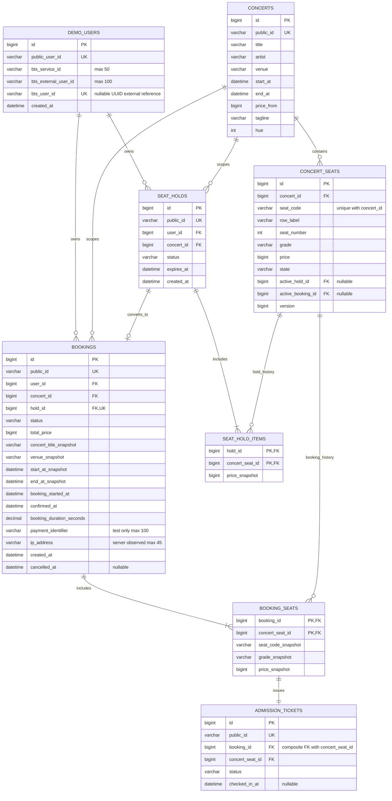
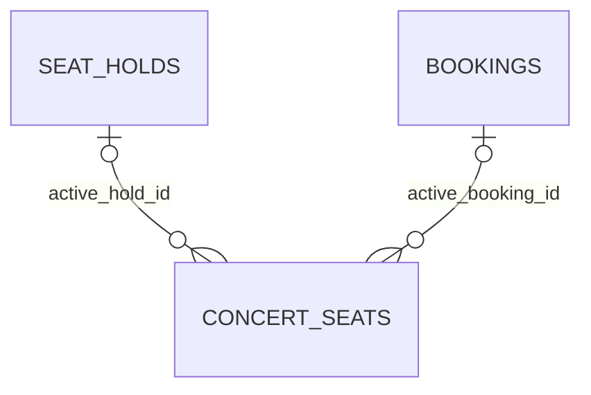
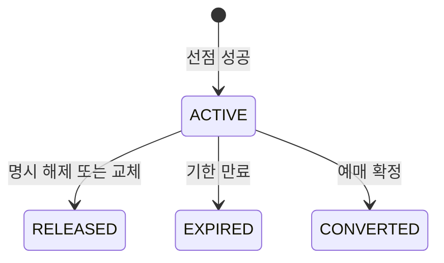
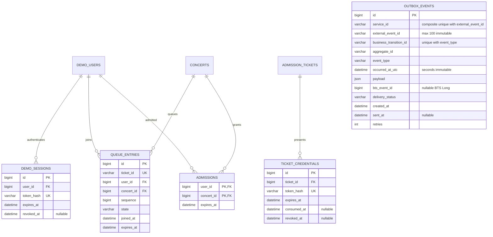

# 데모 티켓팅 ERD 설계안

**Issue #16:** 별도 MySQL 테이블 없이 Redis waiting(일반)/waiting-delayed(후순위), 공통 deadlines/admitted/expired/sequence를 사용한다. CAPTCHA 문제·일회용 인증 증명도 공연 hash tag 아래 TTL이 있는 Redis HASH로 관리한다. 기존 hold/booking 및 BTS 사용자 매핑 스키마는 변경하지 않는다. 실제 BTS 정책 API·실제 CAPTCHA 연동은 미완료이며 [현재 계약](api-spec.md)의 #16을 따른다.

**현재 #15/#17 상태:** FIFO 및 선점 입장 권한은 Redis에서 관리하며 MySQL queue_entries/admissions 테이블은 추가하지 않는다. 선점 생성 서비스에서 현재 ADMITTED를 강제하고 예매 확정은 유효한 본인 hold를 기준으로 한다. 기존 hold/booking 스키마는 그대로 유지한다. 아래 1·2단계 상태와 MySQL 대기열 모델은 구현 이력·초기 제안이며 현재 계약은 [API 명세](api-spec.md)의 #16/#17/#15를 따른다. 실제 BTS 정책·CAPTCHA 서비스와 QR/검표는 후속 범위다.

작성일: 2026-11-01. [API 명세 및 프론트엔드 분석](api-spec.md) 7.2절의 데모 테이블 설계를 관계도로 보완한다. 초기에는 모두 설계 제안이었으며 현재 생성한 SQL/조회 Entity와 미구현 부분은 아래 1단계 상태로 구분한다. FE 타입이 출발점이며 아래 구조가 기존 BTS DB 구조라는 뜻은 아니다.

**1단계 후속 상태:** [backend/db/schema.sql](../backend/db/schema.sql)의 핵심 8개 테이블을 전용 Compose demo-ticketing-mysql(localhost:3308, demo_user, demo-ticketing-mysql-data 볼륨)의 demo_ticketing_db에 적용했다. 공연 3개·좌석 288개 및 SQL 재실행 시 중복 없음을 검증했다. concerts/concert_seats 조회 Entity만 구현했으며 사용자·선점·예매·티켓 테이블은 비어 있다. 세션·대기열·QR 자격증명·Outbox는 후속 단계다. 기존 BTS 컨테이너/볼륨과 분리했다. 상세는 [실행 안내](../backend/README.md) 참조.

seed는 c1/c2/c3·공연별 96석, 모두 AVAILABLE, VIP/R/S 154000/132000/99000원, priceFrom=99000원으로 정합성을 맞춘다. 종료 시각은 시작+3시간의 fixture 제안이다. 기존 데이터는 갱신/초기화하지 않는다. SQL은 공개 ID·외부 ID의 길이와 FK 제약을 명시하며, 구현하지 않은 교차 테이블 공연/소유권 검증은 추후 Service 책임이다.

**2단계 구현:** [02-booking-support.sql](../backend/db/02-booking-support.sql)로 demo_sessions/outbox_events를 추가해 총 10개 테이블을 사용한다. 기존 hold/booking/item/ticket/점유 컬럼을 재사용하며 초기화나 기존 테이블 재작성은 하지 않는다. 선점·예매·취소·소유권 검증을 Service/트랜잭션에 구현했고 CHECK_IN/QR/대기열은 아직 없다. 아래 일반 설계와 실제 선택이 다르면 이 상태를 우선한다.

| 실제 추가 테이블 | 구현 필드/제약 |
|---|---|
| demo_sessions | id PK, user_id FK, token_hash CHAR(64) ascii_bin UNIQUE, expires_at DATETIME(6), expiry INDEX. 원문 token 미저장, 24시간 세션 |
| outbox_events | id PK, user_id FK, service_id/external_event_id 복합 UNIQUE, business_transition_id/event_type 복합 UNIQUE, aggregate_id, event_type, occurred_at_utc, metadata JSON, payload LONGTEXT(JSON_VALID CHECK), delivery_status, lease_token, locked_until, retries, next_attempt_at, bts_event_id BIGINT, last_error_code, created_at, sent_at |

Outbox 상태는 PENDING/IN_FLIGHT/RETRY/SENT/FAILED다. payload NULL인 PENDING/RETRY는 사용자 매핑을 기다리는 원천이며 최초 전송 전 UUID를 결합한 뒤 payload는 불변이다. 타임아웃/worker 중단도 동일 ID와 body로 재전송한다. 같은 aggregate의 순서를 지키고 claim lease와 조건부 결과 갱신을 사용한다. 기존 ‘payload JSON’ 제안과 달리 최종 body를 LONGTEXT로 저장하는 이유는 JSON 출력 재정규화 없이 bytes를 유지하기 위함이다.

좌석 쓰기는 공연 행을 잠근 뒤 수행한다. 같은 사용자·공연의 ACTIVE hold는 이 잠금 아래 한 개로 유지하며 일부 좌석만 성공하는 교체는 없다. 동일 hold 확정은 bookings.hold_id UNIQUE와 상태 재조회로 수렴한다. 입장 티켓은 확정 시 좌석별 생성되고 취소 시 무효화한다. 별도 QR credential 테이블은 아직 없다. 신규 도메인 record는 명시적 JDBC Repository 매핑을 사용하며 API DTO로 직접 반환하지 않는다.

## 1. 범위와 전제

- Spring Boot / Java 17 / Gradle / MySQL 기반의 독립 데모 백엔드다. BTS와 DB/FK를 공유하지 않는다.
- 초기 모델은 공연 한 건을 한 번의 상연으로 다룬다. 회차·공연장·아티스트 별도 master는 현 FE 요구사항에 없다.
- `concert_seats.id`는 내부 식별자다. API의 Seat.id는 A-05 같은 `seat_code`이며 공연 안에서만 유일하다.
- 내부 PK는 BIGINT, 공개 ID는 문자열을 사용하는 안이다. 실제 공개 ID 생성 방식과 길이는 구현 시 확정한다. 사용자가 입력하는 ID와 시스템 생성 공개 ID를 구분한다.
- 금액은 KRW 정수(BIGINT), 날짜는 UTC 기준 DATETIME(6)을 제안한다. API는 ISO 8601로 변환한다. 등급은 VIP/R/S, 좌석 상태는 AVAILABLE/HELD/BOOKED, 예매 상태는 CONFIRMED/CANCELLED를 유지한다.
- 핵심 판매 테이블과 선택 기반 테이블을 구분한다. 결제/카드 테이블은 현재 결제 API나 카드 전송이 없으므로 추가하지 않는다.
- [BTS 확정] 사용자 등록은 serviceId/externalUserId, 반환 userId는 UUID다. 데모 내부 BIGINT와 구분한다. [BTS 연동 설계](bts-integration.md)의 실제 계약을 따르며 아래는 데모 DB 제안이다.
- 위 UTC DATETIME(6) 제안은 데모 업무 날짜에 한정한다. BTS 전송용 occurred_at_utc는 초 단위이며 BTS 기존 DATETIME/LocalDateTime 스키마를 변경하지 않는다. 사용자·Assessment·Policy 시각에도 이벤트 UTC 정책을 일괄 적용하지 않는다.
- [연동 결정] 세 이벤트+metadata로 Feature 원천을 전달한다. 데모에는 Feature 집계 테이블을 추가하지 않는다. 아래 end_at·소요 시간·테스트 결제/IP snapshot·좌석별 입장 티켓은 원천 생산을 위한 신규 모델 제안이다.

## 2. 핵심 판매 관계도

`||`는 정확히 1개, `o|`는 0~1개, `o{`는 0개 이상, `|{`는 1개 이상이다. 필수 자식 수(예: 선점 좌석 1~4개)는 FK만으로 보장되지 않으므로 서비스 검증도 필요하다.

현재 점유 참조는 이력 관계와 별도로 다음과 같다. 한 좌석은 동시에 두 점유 참조를 가질 수 없다.

### 2.1 키와 무결성

| 테이블 | 제약/인덱스 | 의미 |
|---|---|---|
| demo_users | PK(id), UNIQUE(public_user_id) | FE 입력 사용자 ID. 대소문자 구분 및 MySQL collation 정책은 협의 |
| demo_users BTS 매핑 | UNIQUE(bts_service_id, bts_external_user_id), UNIQUE(bts_user_id) | 반환 UUID를 별도 저장. 같은 BTS 계정을 여러 데모 사용자에 연결하지 않는 초기안 |
| concerts | PK(id), UNIQUE(public_id) | API Concert.id 대응 |
| concert_seats | PK(id), UNIQUE(concert_id, seat_code), INDEX(concert_id, state) | 같은 공연 내 좌석 중복 방지. API id와 내부 id 분리 |
| seat_holds | PK(id), UNIQUE(public_id), INDEX(status, expires_at), INDEX(user_id, concert_id) | 만료 대상/본인 선점 조회 |
| seat_hold_items | PK(hold_id, concert_seat_id) | 같은 선점 내 좌석 중복 방지. 좌석의 과거 선점 이력 허용 |
| bookings | PK(id), UNIQUE(public_id), UNIQUE(hold_id), INDEX(user_id, created_at) | hold 하나에서 예매 하나만 확정 |
| booking_seats | PK(booking_id, concert_seat_id) | 같은 예매 내 좌석 중복 방지. 취소 후 재판매 이력 허용 |
| admission_tickets | PK(id), UNIQUE(public_id), UNIQUE(booking_id,concert_seat_id), 복합 FK→booking_seats | 확정 좌석별 안정적인 ticketId. 생성은 같은 예매 확정 트랜잭션에서 보장 |

모든 FK는 내부 PK를 참조한다. bts_user_id는 외부 서비스 ID 문자열이며 FK를 걸지 않는다. 사용자·공연·선점·예매의 이력을 보존하므로 핵심 데이터의 연쇄 삭제는 기본 금지/제한하고 삭제·익명화 정책을 따로 정한다.

### BTS 사용자 매핑 제약

- bts_service_id는 서버 설정 서비스 ID(최대 50자), bts_external_user_id는 최초 저장 후 고정한 외부 ID(최대 100자), bts_user_id는 BTS가 반환한 UUID 문자열이다. 초기 호환안은 데모 public_user_id를 externalUserId로 최초 복사하되 이후 화면 ID가 바뀌어도 재생성하지 않는다.
- serviceId는 인증 키의 서비스와 대소문자까지 일치해야 한다. BTS 요청에서 trim/대소문자 변환을 하지 않으며 중복은 기존 BTS MySQL UNIQUE 비교 규칙을 따른다. 데모 매핑의 collation도 BTS 비교와 어긋나지 않게 확인한다.
- 매핑 완료 전 bts_user_id는 NULL, 서버 간 등록 201/200 성공 후 저장한다. 로컬 저장 실패/응답 유실은 같은 serviceId/externalUserId 재등록으로 복구한다. 두 DB를 한 트랜잭션으로 묶지 않는다. 매핑 실패를 숨기고 새 외부 ID를 발급하지 않는다.
- Credit 70/BASE는 신규 BTS 계정의 기존 Entity 기본값이며 데모 DB에서 Credit 테이블을 복제하거나 재등록 때 초기화하지 않는다. 기존 Credit 누락은 정합성 오류다.
- API Key 원문/해시는 demo_users나 outbox에 저장하지 않는다. 키는 서버 전용 비밀로 관리하며 BTS_API_KEY_HASHES는 BTS 서버의 검증 설정이다.

좌석 점유 조건은 다음을 항상 만족해야 한다. CHECK 제약으로 가능한 행 내부 조건을 검증하고, 선택한 MySQL 버전에서 제약 적용 여부를 확인한다. 교차 테이블 조건은 서비스 트랜잭션에서도 검증한다.

| concert_seats.state | active_hold_id | active_booking_id | 추가 조건 |
|---|---|---|---|
| AVAILABLE | NULL | NULL | 현재 점유 없음 |
| HELD | NOT NULL | NULL | 같은 공연의 ACTIVE hold가 해당 좌석 item을 포함해야 함. expires_at도 유효해야 함 |
| BOOKED | NULL | NOT NULL | 같은 공연의 CONFIRMED booking이 해당 좌석 item을 포함해야 함 |

별도 FK만으로는 hold/booking/좌석의 공연 일치, 소유자 일치, item 포함 여부를 보장하지 못한다. 모든 상태 전이에서 함께 검증해야 한다. `version`은 낙관적 잠금을 쓸 때의 보조 수단이며, 비관적 행 잠금을 쓰는 전체 전략과 일관되게 적용한다.

### 2.2 선점·예매 상태 전이

교체 시 기존 hold는 RELEASED로 전환하고 새 ACTIVE hold를 만드는 안이다. 모든 상태 전이는 좌석 점유 참조와 같은 트랜잭션에서 처리한다. 만료는 서버 시각 기준 `expires_at <= now`로 판정하는 안을 제안하며, 최종 비교 규칙과 시간대는 구현 전에 고정한다.

Booking은 CONFIRMED→CANCELLED만 현재 요구사항이다. PaymentPage의 결제 중/완료는 화면 상태이며 DB의 결제 승인 상태와 같지 않다. PG를 도입할 때 PENDING/PAID/REFUNDED 등을 이 모델에 이미 존재하는 상태처럼 사용하지 않는다.

- 동일 사용자·공연의 ACTIVE hold는 최대 1개를 제안한다. `UNIQUE(user_id, concert_id, status)`만 두면 과거 RELEASED/EXPIRED가 여러 건 남지 못하므로 사용하지 않는다.
- 초기에는 demo_users의 사용자 행을 잠근 뒤 해당 공연의 ACTIVE hold를 조회/교체하는 방식이 가능하다. 같은 사용자의 다른 공연 작업까지 직렬화하는 한계가 있다. 공연별 세밀한 잠금이 필요하면 별도 제어 행을 설계한다. 존재하지 않는 hold 행만 잠그는 방식으로 최초 동시 요청을 막았다고 가정하지 않는다.
- 좌석은 일정 순서로 잠가 다중 좌석 요청의 교착 가능성을 줄인다. 선점 교체는 전부 성공할 때만 commit한다.
- 확정 시 price_snapshot 합계를 서버에서 계산한다. FE 금액은 입력으로 신뢰하지 않는다. 선점 동안 가격을 보장할지 재계산할지는 합의하며, 초기안은 선점 가격 보장이다.
- CANCELLED 예매의 좌석도 이력에는 남는다. 따라서 booking_seats.concert_seat_id를 단독 UNIQUE로 만들면 안 된다. 현재 판매 가능 여부는 concert_seats의 현재 점유로 판단한다.

### 2.3 원천 snapshot과 관람 대상 모델

| 저장 위치 | 필드·제약 제안 | metadata/업무 매핑 |
|---|---|---|
| concerts | end_at > start_at. 신규 실험용 공연은 종료 시각 입력 | 공연 시작/종료를 통해 관람 시점 구분. 기존 FE에는 종료 없음 |
| bookings | start_at_snapshot, end_at_snapshot | BOOKING/CANCEL.metadata.performanceStartsAt/performanceEndsAt에 UTC 초 단위 문자열로 고정 |
| bookings | booking_started_at = 사용 hold.created_at, confirmed_at >= 시작 | 서버 선점 생성~확정 시간. 화면 elapsedMs/대기열 시각 제외 |
| bookings | booking_duration_seconds >= 0, 예: DECIMAL(18,6) | BOOKING.metadata.bookingDurationSeconds. 단일 예매의 원천 시간이며 평균 Feature 아님 |
| bookings | payment_identifier, 최대 100자·서버 테스트 허용 목록 | BOOKING.metadata.paymentIdentifier. 실제 카드번호/그 hash 저장 금지 |
| bookings | ip_address, 최대 45자·유효 IPv4/IPv6 | 성공 예매 요청에서 관측·정규화한 IP. 브라우저 입력/worker IP 사용 금지 |
| admission_tickets | public_id는 발급 후 불변, 상태 ISSUED/CHECKED_IN/CANCELLED 제안 | BOOKING/CANCEL.metadata.ticketIds, CHECK_IN 최상위 ticketId |
| admission_tickets | checked_in_at은 최초 성공 검표에서 한 번 기록 | CHECK_IN.occurredAt을 UTC 초로 고정. 중복 검표는 새 outbox 없음 |

bookings에는 서버 내부 소수 초 시각을 보존할 수 있지만 이벤트 occurredAt은 초 단위다. 같은 hold 재확정은 기존 시간·결제/IP·outbox를 반환하며 다른 요청의 원천값으로 갱신하지 않는다. 동일 ID의 payload에 뒤늦게 누락 metadata를 채워 재전송하면 BTS 409가 되므로 최초 전송 전에 검증·동결한다. 과거 원천 미수집 행은 별도 누락 정책을 적용하며 가짜 정상값을 만들지 않는다.

admission_tickets는 이력과 입장 권한 원장이다. ticket_credentials는 그 티켓을 표현하는 회전 가능한 QR 자격 증명이다. 같은 티켓의 새 QR token으로 입장 횟수가 증가하지 않아야 하며 상태 변경과 CHECK_IN outbox는 같은 트랜잭션에 묶는다. 예매 전체 취소 시 관련 티켓/QR을 무효화한다. 취소·검표 경쟁은 예매/티켓 잠금과 상태 검사로 직렬화하고 취소 이후 성공 입장을 허용하지 않는다.

관람률의 티켓 단위/공연 종료 후 판정은 설계 기준 제안이며 최종 산식·유예/취소 기한은 BTS에서 정한다. 데모는 공연 종료 여부의 집계나 attendance_rate/노쇼 Feature를 계산하지 않는다. 공연 일정 snapshot과 취소·입장 사실을 전송한다. 일정 변경/부분 취소 등은 현재 범위 밖이며 outbox 원본을 고쳐 구현하지 않는다.

## 3. 인증·대기열·QR·연동 테이블

세션·대기열·QR 테이블은 기반 선택에 따라 달라진다. outbox는 이번 BTS 연동안의 기반으로 구체화하며 API 명세 6절의 데모 미정 계약과 분리한다.

| 테이블 | 채택 조건과 주의점 |
|---|---|
| demo_sessions | opaque token 방식 선택 시 사용. 원문 token 대신 hash 저장. JWT/외부 인증 선택 시 저장 구조 재검토. 사용자 등록 API가 이미 token을 발급한다고 가정하지 않음 |
| queue_entries | MySQL 대기열안. WAITING/ADMITTED/LEFT/EXPIRED 같은 내부 상태를 제안하되 API QueueStatus에는 추가하지 않음. INDEX(concert_id, state, sequence), UNIQUE(concert_id, sequence) 권장. 순번 발급은 서버가 원자적으로 처리 |
| admissions | 서버 측 사용자·공연 자격 저장안. 복합 PK(user_id, concert_id)로 재입장/갱신을 처리. 브라우저 sessionStorage를 대체하는 검증 근거 |
| ticket_credentials | 자체 QR 방식의 후보. admission_tickets.id FK. 한 안정적 티켓에 여러 회전 token 이력을 허용. QR 발급 방식은 미정이며 티켓 원장과 분리 |
| outbox_events | BTS BOOKING/CANCEL/CHECK_IN 전달 전용. UNIQUE(service_id, external_event_id), UNIQUE(business_transition_id, event_type). aggregate_id는 논리 참조이며 FK 없음. 만료/선택/조회 신호는 여기에 BTS 이벤트로 적재하지 않음 |

대기열에서도 사용자·공연별 유효 entry 중복은 사용자 행 잠금 또는 별도 현재-entry 제어 구조로 방지한다. 모든 이력에 대해 UNIQUE(user_id, concert_id)를 걸면 재입장이 불가능해진다. Redis 선택 시 queue_entries/admissions의 영속화 필요 여부를 다시 정하고 API DTO와 QueueStore 경계는 유지한다.

QR 갱신 시 이전 토큰 유효 기간·겹침 허용·원문 복원/재발급 방식은 미정이다. 단순 hash 저장만으로 원문 token을 재조회할 수는 없으므로 새 발급 또는 별도 안전한 생성 전략을 설계해야 한다. 소비/취소 무효화는 검표와 경쟁해도 중복 입장이 발생하지 않도록 원자적으로 처리한다.

### Outbox 무결성과 시간

- business_transition_id는 서버의 실제 확정/취소/검표 전이를 식별한다. 하나의 전이에서 행을 한 번 만들고 external_event_id는 최대 100자 문자열(예: UUID)을 한 번만 생성한다. outbox.id·externalEventId·BTS eventId는 서로 다른 ID다.
- 발생 업무와 같은 데모 DB 트랜잭션에서 저장한다. occurred_at_utc는 실제 발생 순간을 UTC 초 단위로 고정한다. payload는 최종 serviceId/externalEventId/BTS UUID/유형/bookingId 또는 ticketId/occurredAt/metadata를 담으며 전송 후에는 수정하지 않는다.
- 매핑 미완료는 WAITING_USER_MAPPING, 전달 대기는 PENDING, 성공은 SENT, 운영 점검은 FAILED 같은 내부 상태를 제안한다. 매핑 완료 후 최초 전송 전에 UUID를 확정하며 재시도 시 현재 매핑/시각/metadata로 재구성하지 않는다.
- metadata는 객체/null 차이와 배열 순서를 보존한다. DB JSON 직렬화에서 객체 키 순서가 바뀌어도 BTS는 동등하게 비교한다. 사용자의 문자열 값과 내부 키는 변환하지 않는다.
- BTS 201/COMMON_201 및 동일 이벤트 200/COMMON_200 모두 성공 기록. bts_event_id는 64비트 BIGINT/Java Long으로 저장한다. 409/DATA_CONFLICT는 새 ID 발급으로 우회하지 않는다.
- 동일 예매 BOOKING→CANCEL 전송 순서와 작업자 중복 실행을 제어한다. outbox 자체 재시도와 별개로 실제 취소/검표 중복 commit도 업무 제약으로 막는다.
- 선점 만료/미입금 횟수와 9종 화면 행동의 저장이 필요하면 데모 내부 이력/텔레메트리로 분리한다. 현재 BTS가 지원하지 않는 종류를 CANCEL/BOOKING으로 위장하지 않는다.
- CHECK_IN의 ticketId는 admission_tickets.public_id를 사용하는 설계안이다. ticket_credentials.id나 QR token과 혼동하지 않는다. BOOKING/CANCEL의 ticketIds·공연 문맥, BOOKING의 duration/paymentIdentifier/ipAddress를 최초 payload에 고정한다. ticket 단위 관람률의 최종 집계 정책은 BTS에서 확인한다.

## 4. API DTO와 테이블 매핑

| FE 타입/기능 | 조회·변경 근거 | 반환 시 주의점 |
|---|---|---|
| 데모 User / BTS UserResponse | demo_users의 공개 ID·외부 ID·반환 UUID 매핑 | 브라우저 userId는 데모 ID, 서버 간 userId는 UUID. 같은 필드명 때문에 덮어쓰지 않음 |
| Concert | concerts | public_id→id, start_at→startAt, price_from→priceFrom |
| Seat | concert_seats + 유효 hold 소유자 | seat_code→id, row_label→row. heldByMe는 서버 인증 주체와 비교 |
| SeatHold | seat_holds + seat_hold_items + concert_seats | public_id→holdId, 공연 public_id→concertId, seat_code 배열→seatIds |
| Booking | bookings + booking_seats | 예매 당시 제목/장소/일시/가격 snapshot으로 반환. userId는 현재 FE Booking 타입의 필드가 아님 |
| QueueTicket / QueueStatus | QueueStore 및 입장 자격 | ticket_id→ticketId. 앞/뒤 인원은 유효 대기자 기준으로 계산, DB sequence 자체를 position으로 반환하지 않음 |
| TicketQr | admission_tickets + 선택한 QR 발급 전략 | token/expiresAt/refreshIntervalSec 또는 null. 내부 hash 미노출. 현재 예매 단일 QR UI와 좌석별 티켓 표현 조정 필요 |
| AccountRisk / BTS 상세 | GET /users/{UUID}의 creditScore/tier/anomalyScore/lastAssessedAt/latestAction | FE baseCredit/penalties/suspicionScore와 다름. 계산 이력 복제나 임의 등급 변환 금지 |

## 5. 구현 전 확인 사항

1. 데모 인증 방식과 안정적인 externalUserId 규칙·collation, 고정 서비스 설정과 UUID 매핑 복구. BTS 등록·키 인증 계약은 확보됨.
2. 선점 5분·4석 제한의 적용 단위, 교체 시 만료/가격 보장, 사용자 잠금 범위.
3. 대기열 MySQL/Redis 선택, 입장 자격 저장·만료·동시 진입 제어, 서버 재시작 시 복구 정책.
4. 좌석별 ticketId 발급안에 따른 검표 주체·QR 표현(예매 단일 QR UI 조정), 토큰 갱신/소비/취소 무효화, BTS 관람률 최종 단위/기간.
5. 실제 BTS schema에 맞는 세 이벤트 생성, 고정 externalEventId/payload·초 단위 UTC, 재시도/격리/보존. 기존 BTS KST 데이터는 별도 승인 없이 변환하지 않음.
6. 실제 MySQL 버전에 따른 CHECK/잠금 동작 검증, PK/FK migration 순서. 순환 참조인 concert_seats의 active_hold_id/active_booking_id FK는 대상 테이블 생성 후 추가할 수 있음.
7. SQL은 기존 BTS 관리 컨벤션에 맞춰 별도 데모 DB용으로 준비하되 실제 파일 경로/명명·적용 규칙을 소스에서 확인한 뒤 확정. 새 도구 도입·기존 테이블 초기화·BTS 스키마 수정은 이번 범위가 아님.
8. IP 신뢰 프록시 CIDR/hop과 정규화, 테스트 paymentIdentifier 목록, 서버 시작/종료 시각 검증, metadata 추출기의 누락/지연 처리. BTS의 Feature 조회는 데모 DB를 직접 참조하지 않음.

문서 검토에서는 API 필드 매핑, PK/FK 및 관계 수, 취소 후 재판매와 이력 보존, 선택 테이블 범위를 확인했다. 핵심 DDL의 PK/FK/UNIQUE/CHECK와 인덱스가 MySQL에 생성됐고 조회 통합 테스트가 통과했다. Mermaid 렌더러 검증 및 향후 예매/선점 경쟁 테스트는 별도다.
